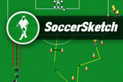

# SoccerSketch

SoccerSketch was my first project. I built it to help football coaches draw
training drills and explain their ideas with players, pitches, equipment,
arrows, and text.

This repository brings together the original Adobe Flash source, the releases
I have collected over the years, and a version you can use in a modern browser.
The **HTML/JavaScript port was created by GPT-6.1-sol**, using the original
SoccerSketch source and artwork.

**[Open SoccerSketch in your browser](https://www.barkmin.eu/soccersketch/)**

## A little history

The original SoccerSketch was built with Flash/ActionScript and distributed
for desktop and mobile platforms using Adobe AIR.

The [original SourceForge project](https://sourceforge.net/projects/soccersketch/)
was registered on **January 28, 2012**. Its
[release archive](https://sourceforge.net/projects/soccersketch/files/) records
**2.5.0 releases from November 17, 2013**, with downloads for Windows,
Mac/Linux, and Android. Those pages preserve a little of the project's life
before this repository.

## What's in the repository

| Path | Contents |
| --- | --- |
| [`SoccerSketch_Desktop.fla`](SoccerSketch_Desktop.fla) | The original Flash source file. |
| [`archive/`](archive/) | 63 historical releases I have collected over the years: Windows executables, Adobe AIR packages, Android APKs (including Amazon editions), BlackBerry AIR packages, and an iOS IPA. |
| [`index.html`](index.html), `app.js`, `project.js`, `styles.css` | The browser editor and its project/file handling. |
| [`assets.js`](assets.js), [`assets/`](assets/) | Artwork recovered from the original project, including players, equipment, pitches, and controls. |
| [`promos.js`](promos.js) | Local banners linking to Openpatch projects. |
| [`tests/`](tests/) | Browser regression checks. |
| [`tools/`](tools/) | The original asset exporter; it requires an extracted XFL project in its original directory layout. |

The archived packages are preserved as historical releases. The browser port
is the version to use on current systems.

## Run locally

Open [`index.html`](index.html) in a modern browser. The editor is self-contained:
no Flash, package installation, build step, or internet connection is required.

Alternatively, serve the repository root:

```sh
python3 -m http.server 8080
```

Then open <http://localhost:8080>.

## Draw a drill

- Choose a pitch, a player or equipment category, and a color. Click the pitch
  to place a symbol, or drag it from the palette.
- Drag symbols to move them; use the selection handles to resize and rotate.
  **Shift-click** selects multiple symbols. Right-click for more actions.
- Press **V** to select, **L** to draw lines and arrows, or **T** to add text.
  Double-click a text label to edit it.
- Use **Ctrl/Cmd+Z** to undo, **Ctrl/Cmd+Shift+Z** to redo,
  **Ctrl/Cmd+D** to duplicate, and **Delete** to remove a selection.
- Choose **Speichern** or press **Ctrl/Cmd+S** to download an editable JSON
  project. Choose **Öffnen**, or drop a project onto the pitch, to reopen it.
- Export drills as JPEG, PNG, SVG, or desktop `.ssdf` files, or print to
  paper/PDF. Exports contain the drill without the editor controls or banners.

The current drill is saved automatically in browser storage. Download JSON
projects to keep a portable copy.

### Desktop file compatibility

The web port can import and export the original `.ssdf` format. JSON preserves
all web editor data; SSDF cannot represent every web feature, including the
project title, custom text colors, and custom line thickness. Indoor symbols
cannot be exported to SSDF because their ActionScript classes were missing
from the available source.

Some external ActionScript drawing classes were also missing. Their behavior
was recreated in JavaScript using the original save/load scripts as a
reference. Historical SSDF files may expose differences in curve handling.

## Checks

With Node.js 22+ and Chromium installed:

```sh
node tests/run.mjs
```

You can also open [`tests/index.html`](tests/index.html) in a browser. The checks
exercise editing, drawing, persistence, JSON/SSDF round trips, image exports,
banners, and mobile layout. Use a separate browser profile for manual runs:
the checks change the editor's automatically saved draft.

## Publishing

[GitHub Actions](.github/workflows/pages.yml) publishes the web editor to
GitHub Pages on every push to `main`. It can also be run manually from the
repository's Actions tab. Only the browser files are included in the site;
the Flash source and historical packages remain available in this repository.
